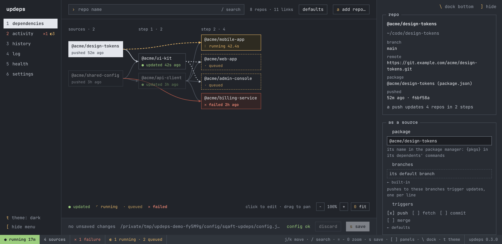
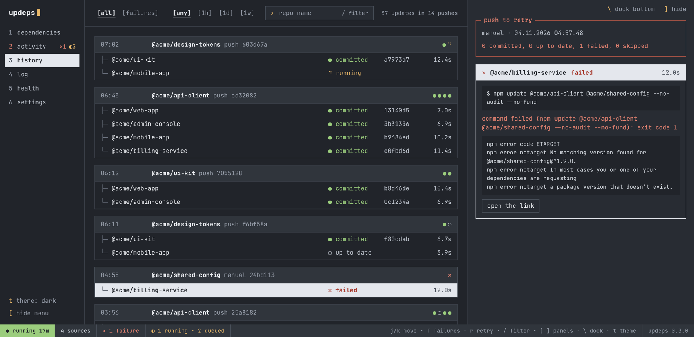
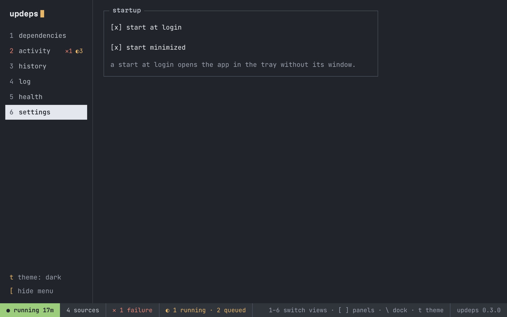

# @sqaft/updeps-gui

The desktop app for [updeps](https://github.com/sqaft/sqaft-updeps-cli), on macOS,
Linux and Windows. It draws your repos and their links as a map, shows what the
daemon is doing, and edits the config.

<picture>
  <source media="(prefers-color-scheme: dark)" srcset="docs/screenshots/dependencies-dark.png">
  <source media="(prefers-color-scheme: light)" srcset="docs/screenshots/dependencies-light.png">
  
</picture>

- **Dependencies**: every repo and link on a map, in columns by steps from the
  sources, each repo with what the daemon is doing or did last. Select a repo
  to light what a push to it updates; the rest dims. Zoom with cmd/ctrl and the
  wheel, pinch or `=`, `-` and `0` (fit), and drag the background to pan. Click a repo or a link on the map to edit it. Add repos, link a package to the repos that
  depend on it, and edit each link's commands, triggers, branches and safety
  settings; a value a link inherits shows where it comes from. Every edit is
  checked by updeps as you type (errors, unknown fields, loops) and written to
  the config file when you save; a running daemon picks it up right away.
- **System tray**: the daemon's state at a glance. The icon shows whether it is
  stopped, running a job, or has open failures; on macOS the counts (`⚠2 ⧗1`) sit
  next to it. The menu lists the running job, the queue and open failures, and
  can retry failures, start, stop or restart the daemon, and clear run data.
- **Activity**, **History**, **Log** and **Health check** views: what runs now
  with its latest log lines and the queue, every update grouped by the push that
  started it with its commands and output, the log in columns with filters, and
  `updeps doctor` as a checklist.

  

- **Settings**: start at login and start minimized (see [Start at login](#start-at-login)).

  

The window has a soft dark theme and a light one; `t` (or the button above
**hide menu**) cycles `system` (follows the operating system, the default),
`dark` and `light`, and the choice is remembered. It works from the keyboard:
`1`–`6` switch views, `[` and `]` fold the menu on the left and the details panel
(drag their inner edge to resize them, double-click it for the default size),
`\` docks the details panel on the right or at the bottom, where each of its
sections is a tab (`,` and `.` switch tabs), `R` restarts the daemon, and the statusline at the bottom lists the
keys of the view you are in (`j`/`k` to move, `/` to search, `=`, `-` and `0` to
zoom the map, `s` to save, `r` to retry…).

The app works with the updeps CLI installed on the same computer, the one the
daemon runs: it reads the config, state and journal through the CLI's API
(`@sqaft/updeps-cli/api`) and runs the CLI for actions. It has no copy of
updeps of its own, so the two never disagree about the config format.

---

## Installation

The updeps CLI installs and opens the app:

```bash
npm install -g @sqaft/updeps-cli
updeps gui            # offers to install the app the first time, then opens it
updeps gui install    # installs or updates it
updeps gui uninstall  # removes it
```

`updeps gui install` puts the app in updeps' own data directory
(`~/.local/share/sqaft-updeps/gui`, `%LOCALAPPDATA%\sqaft-updeps\gui` on
Windows) with npm, so nothing is installed globally. It downloads Electron
during the install (about 100 MB, 350 MB on disk). Requires Node.js 22+. The app tells you when the installed updeps
CLI is too old for it.

The app can also be installed on its own with `npm install -g @sqaft/updeps-gui`
and started with `updeps-gui`.

The window opens and the app stays in the system tray when you close it. To
start it at login, turn on **start at login** in the settings view or **Start at
login** in the tray menu.

### Updates

`updeps gui` offers to update the app when a newer version is published, and
`updeps gui install` updates it. The app also checks (through the CLI, at most
once a day) and shows what it finds: a chip in the statusline, an item at the top
of the tray menu, and an **updates** box in the health view with the command to
run, for the app (`updeps gui`) and for the CLI. A checkout run with `npm start`
never announces an app update. The app does not install updates itself.

On macOS the app is in the Dock and Cmd+Tab as **updeps** while its window is
open. It runs from `updeps.app` in `~/Library/Application Support/updeps`, a copy
of the Electron.app that npm installs (an APFS clone, so it takes no extra
space) with updeps' name and icon, signed again locally. It is prepared by
`updeps gui install` and rebuilt when Electron is updated.

On Linux the tray needs a StatusNotifier/AppIndicator host: KDE, Xfce and most
desktops have one; on GNOME install the "AppIndicator and KStatusNotifierItem
Support" extension (Ubuntu ships it).

```
updeps-gui [--hidden] [--login] [--foreground]
updeps-gui --prepare
updeps-gui --quit

  --hidden       start in the system tray without opening the window
  --login        started by the login entry; follows the start minimized setting
  --foreground   stay attached to the terminal and print the app's output
  --prepare      download Electron and, on macOS, build updeps.app, then exit
  --quit         ask a running app to quit and wait until it is gone; exits 0
                 when none is running
```

### Finding the CLI

`updeps gui` tells the app which CLI install opened it (`UPDEPS_CLI`), and the
app remembers that install for its next starts, including at login. Started
any other way, it looks for the `updeps` command on its PATH; since an app
started from the Dock, a desktop launcher or at login gets a minimal PATH, it
also asks your login shell for its PATH (macOS, Linux). To use a specific
install, set `UPDEPS_CLI` to its package directory (for example a working copy
of `sqaft-updeps-cli`). If no CLI is found, the window says how to install it.

### Start at login

The settings view has two switches: **start at login** adds or removes the login
entry (the tray's **Start at login** is the same switch), and **start minimized**
decides whether a start at login opens in the tray without the window (the
default) or with it. Starting the app any other way (`updeps gui`, the Dock, a
launcher) always opens the window. The entry passes `--login`, and the app reads
the choice, kept in `settings.json` in its user data directory, when it starts, so
changing it does not rewrite the entry.

| Platform | Entry |
|---|---|
| macOS | `~/Library/LaunchAgents/com.sqaft.updeps.gui.plist` |
| Linux | `~/.config/autostart/sqaft-updeps-gui.desktop` |
| Windows | the user's Run key (Task Manager › Startup apps) |

On macOS and Linux the entry runs `node` through the PATH saved when you turn the
option on, like the updeps daemon does, so Node.js upgrades keep working; turn it
off and on again after switching Node.js versions. On Windows it starts Electron
directly, so no console window opens at login.

---

## Security

The window's page is sandboxed with context isolation and no Node.js access. It
reaches the main process only through a fixed set of calls (`src/preload.cjs`;
one of them sets the theme, and the main process accepts only `system`, `dark`
or `light`), and the only CLI commands the app runs are `start`, `stop`, `restart`, `retry`,
`run`, `reset`, `doctor` and `graph`. Credentials in a repo's `origin` URL are
masked before they are shown.

---

## Development

```bash
git clone https://github.com/sqaft/sqaft-updeps-gui
cd sqaft-updeps-gui
npm install
npm start                 # runs the app from the working copy (on macOS under Electron's name)
UPDEPS_GUI=$PWD updeps gui   # opens this working copy through the CLI
npm test                  # node:test, no Electron needed
npm run icons             # redraws assets/ (tray and app icons)
npm run screenshots -- <dir> [view[:repo][+folded][+bottom][+updates][+autostart][+<width>x<height>][+dark|+light] ...]   # a PNG of each view
npm run screenshots:demo  # redraws docs/screenshots/ from mock data (nothing real is read)
```

There is no build step: the main process and the page are plain ES modules, and
the page loads its files and fonts over the app's own `app://updeps/` scheme.

CI runs the tests on macOS, Linux and Windows. Publishing happens from CI: when
the `version` in `package.json` is not on npm yet, the `publish` job in
`.github/workflows/test.yml` publishes it after the tests pass.

---

## License

MIT — see [LICENSE](LICENSE).
